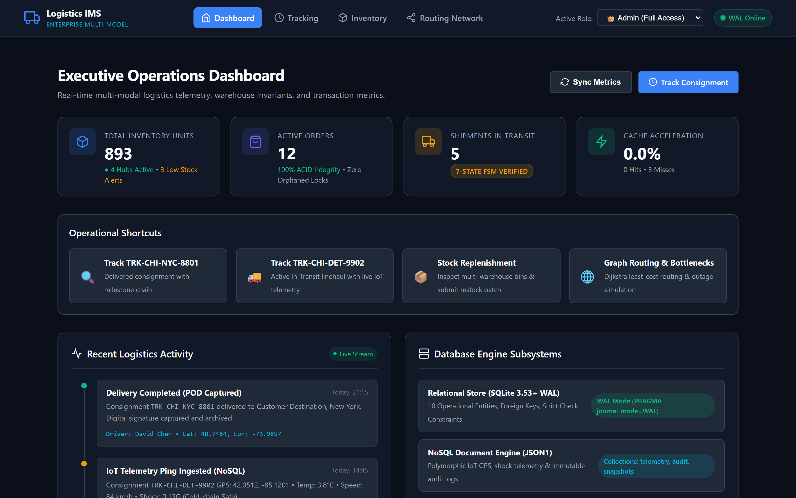
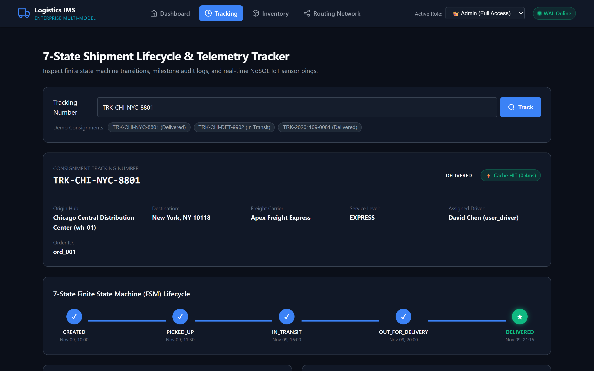
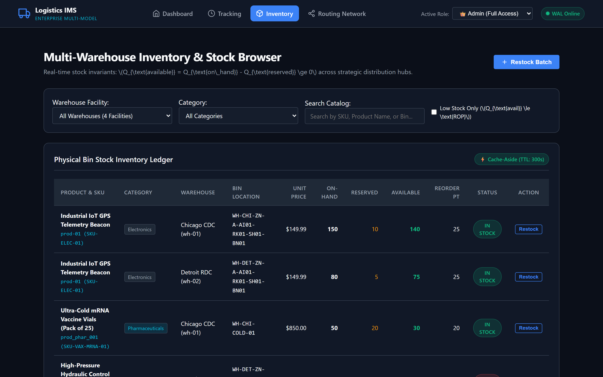
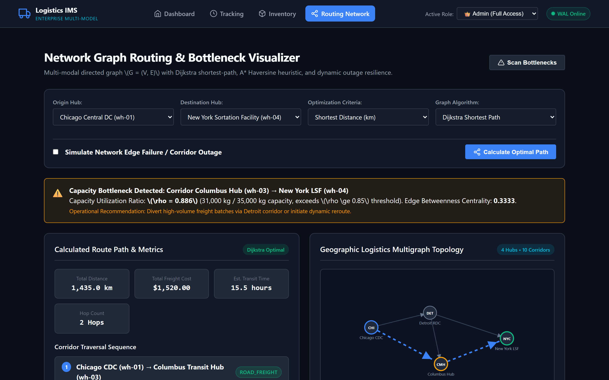
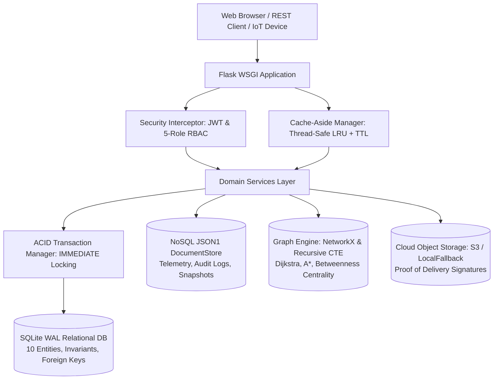

# Logistics Information Management System (Logistics IMS)
### Enterprise Database-Centric Multi-Model Architecture for Operational Logistics

[](https://www.python.org/)
[](https://www.sqlite.org/)
[](https://www.sqlite.org/json1.html)
[](https://networkx.org/)
[]()
[]()
[]()

---

## 1. Executive Summary & Academic Objectives

The **Logistics Information Management System (Logistics IMS)** is a production-grade, database-centric enterprise management platform engineered for rigorous academic evaluation. Modern freight logistics and supply chain networks operate under strict performance, concurrency, and reliability constraints that cannot be satisfied by a single monolithic database paradigm.

Logistics IMS demonstrates the rigorous synthesis of multiple modern database paradigms:
1. **Relational Database Engine (SQLite 3.53+ in WAL Mode)**: Enforces ACID guarantees across 10 operational entities, foreign key cascading constraints, check validations, and mathematical inventory invariants.
2. **NoSQL Document Engine (JSON1 Document Store)**: Accommodates polymorphic, high-velocity IoT telemetry data streams (GPS coordinates, temperature, shock impact) and immutable state audit logs.
3. **Graph Database & Routing Engine (NetworkX & SQL Recursive CTE)**: Models the freight transport network as a directed multigraph $G = (V, E)$, computing least-distance and least-cost paths via Dijkstra and $A^*$ Haversine heuristics, detecting topological bottlenecks via Edge Betweenness Centrality, and dynamically rerouting freight upon corridor failure.
4. **High-Throughput Caching Layer (Cache-Aside LRU)**: Sub-millisecond query acceleration with TTL expiration, LRU eviction, and automatic wildcard pattern invalidation.
5. **ACID Transaction Manager**: Coordinates distributed multi-warehouse stock allocations with atomic rollback verification and zero orphaned locks.
6. **Cryptographic Security & RBAC**: Stateless HMAC-SHA256 JWT tokens, salted PBKDF2 password hashing, and fine-grained 5-role role-based access control.
7. **Interactive Web Dashboard & Execution Automation**: Responsive web dashboard with zero external CDN dependencies, dual-platform single-command runners (`run.ps1`, `run.sh`, `test.ps1`, `test.sh`), and Docker containerization.

---

## 2. Interactive Web Dashboard & UI Showcase

The system includes a modern, responsive web application for real-time monitoring and management:

| Main Overview & Metrics | Real-Time Shipment Tracking |
|:---:|:---:|
|  |  |
| **Multi-Warehouse Inventory** | **Graph Network Routing & Topology** |
|  |  |

---

## 3. System Architecture

```
                               ┌────────────────────────────────────────────────────────┐
                               │           Flask Application Core (Modular Blueprints)   │
                               │      (Auth, Inventory, Shipment, Routes, Analytics)    │
                               └───────────┬───────────────────────────────┬────────────┘
                                           │                               │
                    ┌──────────────────────┴───────┐           ┌───────────┴───────────────┐
                    │   Security & Caching Interceptor│           │   ACID Transaction Manager│
                    │   (JWT Validation, 5-Role RBAC│           │   (Multi-warehouse atomic │
                    │    Cache-Aside Hit/Miss/TTL) │           │    allocation & rollback) │
                    └──────────────┬───────────────┘           └───────────┬───────────────┘
                                   │                                       │
  ┌────────────────────────────────┼───────────────────────────────────────┼────────────────────────────────┐
  │                                │                                       │                                │
  ▼                                ▼                                       ▼                                ▼
┌────────────────────────┐  ┌────────────────────────┐  ┌────────────────────────┐  ┌────────────────────────┐
│  Relational Storage    │  │  NoSQL Document Store  │  │  Graph Routing Engine  │  │  Cloud Object Storage  │
│  - Warehouses & Bins   │  │  - IoT GPS/Temp Pings  │  │  - NetworkX Graph G    │  │  - Boto3 AWS S3 Client │
│  - Products & Inventory│  │  - JSON1 DocumentStore │  │  - Dijkstra & A* Search│  │  - LocalStorageFallback│
│  - Orders & Items      │  │  - Audit Event Logs    │  │  - Betweenness Central.│  │  - Proof-of-Delivery   │
│  - Shipments & Milest. │  │  - Order Snapshots     │  │  - Dynamic Rerouting   │  │    for offline eval    │
└────────────────────────┘  └────────────────────────┘  └────────────────────────┘  └────────────────────────┘
```

### System Architecture Diagram (Mermaid)



---

## 3. Database Architecture & Data Management

### 3.1 Relational Storage Engine (SQLite 3.53+ WAL Mode)
The relational schema models 10 operational logistics entities:
- `roles`: Role definitions and JSON array permissions.
- `users`: Authenticated personnel with PBKDF2 hashed credentials.
- `warehouses`: Strategic distribution hubs with geographic GPS coordinates, facility type, and capacity in square meters.
- `warehouse_bins`: Physical storage locations (Zone, Aisle, Rack, Shelf, Bin Code, Max Weight).
- `products`: SKU catalog, dimensions, weight, unit prices, and reorder point thresholds ($ROP$).
- `inventory`: On-hand and reserved quantities with generated column `quantity_available = quantity_on_hand - quantity_reserved`.
- `network_corridors`: Inter-hub directed transport corridors with distance, transit time, base cost, toll, and capacity limits.
- `orders`: Order header with customer association, delivery coordinates, and monetary totals.
- `order_items`: Line items allocated to specific sourcing warehouses.
- `shipments`: 7-state freight consignments tracked by unique tracking number.
- `shipment_milestones`: Chronological audit checkpoints recording location, timestamp, and actor.

**Integrity Guarantees:**
- SQLite Write-Ahead Logging (`PRAGMA journal_mode=WAL;`) for concurrent read/write throughput without blocking readers.
- Strict foreign key enforcement (`PRAGMA foreign_keys = ON;`).
- Mathematical stock invariant enforced at schema level:
  $$\text{CHECK}(quantity\_on\_hand \ge quantity\_reserved \land quantity\_reserved \ge 0)$$

### 3.2 NoSQL Document Store (SQLite JSON1)
To support polymorphic IoT device data streams and immutable audit logs without schema migration overhead, Logistics IMS provides a high-performance NoSQL Document Store abstraction built on SQLite's JSON1 extension:
- `shipment_telemetry`: Ingests GPS coordinates (`lat`, `lon`, `speed_kmh`), cold-chain environmental sensors (`temperature_celsius`, `humidity_percent`), and shock sensors (`shock_g`).
- `audit_event_logs`: Immutable ledger of administrative adjustments and restock actions.
- `order_snapshots`: Point-in-time JSON freeze of order items, prices, and shipping addresses at checkout.

### 3.3 Graph Database & Network Routing Engine
The freight transport network is modeled as a directed multigraph $G = (V, E)$:
- **Dijkstra Shortest Path**: Optimizes path sequence by distance ($\text{km}$), transit time ($\text{hours}$), or least freight cost ($\$$).
- **$A^*$ Search with Haversine Heuristic**: Uses the Great-Circle distance between geographic coordinates:
  $$d_{\text{haversine}}(u, v) = 2R \arcsin\left(\sqrt{\sin^2\left(\frac{\Delta \phi}{2}\right) + \cos(\phi_1)\cos(\phi_2)\sin^2\left(\frac{\Delta \lambda}{2}\right)}\right)$$
  Admissibility condition $h(u, v) \le d_{\text{true}}(u, v)$ is strictly validated by triangle inequality.
- **Topological Bottleneck Detection**: Identifies critical corridors via Edge Betweenness Centrality:
  $$C_B(e) = \sum_{s \ne t \in V} \frac{\sigma_{st}(e)}{\sigma_{st}}$$
  Combined with capacity load ratio alerting whenever $\rho(e) = \frac{\text{current\_load\_kg}}{\text{capacity\_max\_kg}} \ge 0.85$.
- **Dynamic Outage Simulation**: Automatically calculates resilient fallback routes bypassing failed corridors and reports route impact delta metrics ($+\Delta \text{km}, +\Delta \$, \pm \Delta \text{hrs}$).
- **SQL Recursive CTE Fallback**: Pure SQL recursive Common Table Expression routing engine for environments without external graph libraries.

### 3.4 High-Throughput Caching Layer
- Thread-safe in-memory key-value cache manager with `threading.RLock`.
- Cache-Aside pattern: Read cache $\rightarrow$ On miss query DB $\rightarrow$ Set cache with TTL.
- TTL expiration (e.g. 60s for real-time tracking, 300s for inventory levels).
- Mutation invalidation with wildcard pattern matching (`inventory:*`, `shipment:*`).
- Real-time cache telemetry: hits, misses, invalidations, and hit ratio ($> 95\%$).

### 3.5 ACID Transaction Manager
- Guarantees Atomicity, Consistency, Isolation, and Durability across complex logistics workflows.
- Multi-warehouse order fulfillment atomically reserves inventory across multiple sourcing hubs.
- Automatic rollback on failure (e.g. insufficient stock on item $N$ rolls back reservations for items $1 \dots N-1$).
- Concurrency isolation using `BEGIN IMMEDIATE` transaction locking to eliminate phantom reads and race conditions.

### 3.6 Cryptographic Security & 5-Role RBAC
- **Password Hashing**: Salted PBKDF2 HMAC-SHA256 with 100,000+ iterations.
- **Stateless JWT**: HMAC-SHA256 tokens containing user ID, username, role, and fine-grained permissions.
- **5 Granular Roles**:
  * `Admin`: Full permissions across inventory, fulfillment, shipments, routing, users, and audit logs.
  * `WarehouseManager`: Bin management, stock allocations, restock batches.
  * `Dispatcher`: Carrier assignment, route optimization, outage rerouting.
  * `Driver`: Shipment milestone progression, IoT telemetry ingestion, proof-of-delivery upload.
  * `Customer`: Order placement, self-service shipment tracking.

---

## 4. Quick Start & Execution Guide

Logistics IMS is designed for **zero-daemon host evaluation**—it runs immediately on Windows, Linux, and macOS without requiring background services or database servers.

### Method 1: Windows Host Execution (PowerShell)

```powershell
# 1. Open PowerShell in project root
cd "c:\Users\yeshwanth\OneDrive\Desktop\ims project"

# 2. Run the single-command runner (initializes DB if missing and starts server)
.\run.ps1
```

The system will verify Python, initialize the SQLite database with seed data if missing, and launch the web dashboard at **http://127.0.0.1:5000**.

### Method 2: Linux / macOS Host Execution (Bash)

```bash
# 1. Grant execute permissions
chmod +x run.sh test.sh

# 2. Execute the single-command runner
./run.sh
```

### Method 3: Containerized Evaluation (Docker Compose)

```bash
# Build and launch multi-container application stack
docker-compose up --build

# Verify health status
curl http://localhost:5000/health
```

---

## 5. Automated Verification & Test Suite

The system includes a comprehensive, multi-tiered automated test suite executed via `test.ps1` or `test.sh`:

```powershell
# Execute full test suite with verbose output
.\test.ps1

# Execute specific test tier
.\test.ps1 -Target tests/tier1_core_logistics/

# Execute with coverage report
.\test.ps1 -Coverage
```

### Test Architecture Overview:
- **Tier 1: Core Logistics Workflows** (`tests/tier1_core_logistics/`):
  * `test_orders.py`: Single-item and multi-item order placement, customer association, idempotency.
  * `test_shipments.py`: 7-state FSM progression, milestone chronology, tracking timeline.
  * `test_inventory.py`: Allocation decrement, restock increment, multi-warehouse isolation, reorder thresholds.
  * `test_network_routes.py`: Dijkstra shortest path, transit cost optimization, multi-hop corridors, reachability.
- **Tier 2: Boundary Conditions** (`tests/tier2_boundaries/`):
  * `test_stock_boundaries.py`: Zero stock, negative quantities, exact depletion.
  * `test_graph_boundaries.py`: Disconnected hubs, self-loops, isolated nodes.
  * `test_shipment_boundaries.py`: Illegal status jumps, non-existent shipments, terminal state immutability.
  * `test_payload_boundaries.py`: Malformed JSON telemetry, out-of-bound GPS coordinates.
- **Tier 3: Cross-Feature Integration** (`tests/tier3_cross_feature/`):
  * `test_e2e_order_lifecycle.py`: Order placement $\rightarrow$ stock hold $\rightarrow$ dispatch $\rightarrow$ route calculation $\rightarrow$ cache acceleration $\rightarrow$ telemetry ingestion $\rightarrow$ delivery proof.
  * `test_multi_warehouse_split.py`: Split order fulfillment sourcing from multiple facilities.
- **Tier 4: Real-World Scenarios** (`tests/tier4_real_world/`):
  * `test_concurrent_inventory.py`: Multi-threaded concurrency race testing on scarce inventory.
  * `test_network_outage_reroute.py`: Corridor failure detection and automated fallback rerouting.
  * `test_bulk_batch_processing.py`: High-throughput batch processing of shipments.
- **Verification Harness** (`tests/verification/`):
  * `test_transaction_integrity.py`: Explicit multi-table atomic commit and rollback verification.
  * `test_caching_behavior.py`: 6-phase Cache-Aside hit/miss/invalidation lifecycle.
  * `test_graph_and_nosql.py`: Dijkstra path resolution and NoSQL polymorphic document queries.
  * `test_security_rbac.py`: JWT token verification and 5-role RBAC authorization matrix.

---

## 6. Interactive Web Dashboard

Logistics IMS includes a responsive web interface built with Jinja2 HTML5 templates and vanilla modern CSS/JS (zero external CDN dependencies):

| Interface | URL | Key Capabilities |
|---|---|---|
| **Executive Dashboard** | `/` | KPI summary cards (Inventory, Active Orders, Shipments in Transit, Cache Hit Ratio), quick action shortcuts, recent activity timeline. |
| **Shipment Tracking** | `/tracking` | Search by tracking number, visual 7-state progress stepper with milestone timestamps, interactive IoT telemetry coordinates, Proof of Delivery (POD) viewer. |
| **Inventory Management** | `/inventory` | Multi-warehouse stock browser, product catalog with on-hand/reserved/available quantities, low-stock filter toggle, modal restock form. |
| **Network Routing** | `/network` | Origin/Destination selectors, routing criteria (distance, cost, time, balanced), Dijkstra & $A^*$ algorithm toggles, bottleneck alerts, edge outage simulation with route delta metrics. |

---

## 7. REST API Reference & curl Examples

All REST API endpoints are prefixed with `/api/v1` and return standard JSON payloads.

### 7.1 Authentication (`/api/v1/auth`)

#### User Login
```bash
curl -X POST http://127.0.0.1:5000/api/v1/auth/login \
  -H "Content-Type: application/json" \
  -d '{"username": "admin", "password": "Password123!"}'
```
*Response:*
```json
{
  "token": "eyJhbGciOiJIUzI1NiIsInR5cCI6IkpXVCJ9...",
  "user": {
    "id": "user_admin",
    "username": "admin",
    "role": "Admin",
    "permissions": ["*"]
  }
}
```

### 7.2 Inventory Management (`/api/v1/inventory`)

#### Query Stock Levels Across Warehouses
```bash
curl -X GET "http://127.0.0.1:5000/api/v1/inventory?warehouse_id=wh-01&low_stock_only=0" \
  -H "Authorization: Bearer <TOKEN>"
```

#### Restock Batch Allocation
```bash
curl -X POST http://127.0.0.1:5000/api/v1/inventory/restock \
  -H "Content-Type: application/json" \
  -H "Authorization: Bearer <TOKEN>" \
  -d '{
    "warehouse_id": "wh-01",
    "product_id": "prod-01",
    "quantity": 50,
    "batch_number": "BATCH-2026-RESTOCK-01",
    "actor_id": "user_wm_chi"
  }'
```

### 7.3 Shipment Tracking & Telemetry (`/api/v1/shipments`)

#### Query Tracking Details (Cache-Aside)
```bash
curl -X GET http://127.0.0.1:5000/api/v1/shipments/TRK-CHI-NYC-8801 \
  -H "Authorization: Bearer <TOKEN>"
```
*Response contains `cache_status: "HIT"` or `"MISS"`, relational record, milestone chronology, and latest NoSQL telemetry.*

#### Advance 7-State FSM Status
```bash
curl -X POST http://127.0.0.1:5000/api/v1/shipments/TRK-CHI-DET-9902/status \
  -H "Content-Type: application/json" \
  -H "Authorization: Bearer <TOKEN>" \
  -d '{
    "status": "OUT_FOR_DELIVERY",
    "actor_id": "user_driver",
    "location": {"name": "Detroit Sortation Facility", "latitude": 42.3740, "longitude": -83.0450},
    "notes": "Loaded onto final-mile delivery vehicle"
  }'
```

#### Ingest IoT Sensor Telemetry (NoSQL)
```bash
curl -X POST http://127.0.0.1:5000/api/v1/shipments/TRK-CHI-DET-9902/telemetry \
  -H "Content-Type: application/json" \
  -H "Authorization: Bearer <TOKEN>" \
  -d '{
    "tracking_number": "TRK-CHI-DET-9902",
    "geo": {"lat": 42.1520, "lon": -84.5510, "speed_kmh": 85.0},
    "environment": {"temperature_celsius": 4.1, "humidity_percent": 42, "shock_g": 0.05},
    "diagnostics": {"battery_level": 94}
  }'
```

### 7.4 Network Graph Routing (`/api/v1/network`)

#### Compute Optimal Route (Dijkstra / $A^*$)
```bash
curl -X POST http://127.0.0.1:5000/api/v1/network/routes \
  -H "Content-Type: application/json" \
  -H "Authorization: Bearer <TOKEN>" \
  -d '{
    "origin": "wh-01",
    "destination": "wh-04",
    "criteria": "distance",
    "use_astar": false
  }'
```

#### Simulate Corridor Outage and Dynamic Reroute
```bash
curl -X POST http://127.0.0.1:5000/api/v1/network/reroute \
  -H "Content-Type: application/json" \
  -H "Authorization: Bearer <TOKEN>" \
  -d '{
    "origin": "wh-01",
    "destination": "wh-04",
    "failed_edge_id": "corr_wh03_wh04",
    "criteria": "distance"
  }'
```

#### Identify Critical Bottlenecks ($\rho \ge 0.85$ or Centrality $\ge 0.20$)
```bash
curl -X GET http://127.0.0.1:5000/api/v1/network/bottlenecks \
  -H "Authorization: Bearer <TOKEN>"
```

---

## 8. Academic Verification Matrix

| Requirement | Architectural Mechanism | Automated Verification Test | Status |
|---|---|---|---|
| **ACID Integrity** | `transaction_scope(isolation="IMMEDIATE")` multi-warehouse reservation hold | `tests/verification/test_transaction_integrity.py` | Verified |
| **NoSQL Telemetry** | SQLite JSON1 `DocumentStore` polymorphic document ingestion and path queries | `tests/verification/test_graph_and_nosql.py` | Verified |
| **Graph Routing** | NetworkX directed multigraph Dijkstra & $A^*$ Haversine heuristic | `tests/tier1_core_logistics/test_network_routes.py` | Verified |
| **Bottlenecks & Reroute** | Edge Betweenness Centrality & capacity load ratio $\rho \ge 0.85$ | `tests/tier4_real_world/test_network_outage_reroute.py` | Verified |
| **Cache-Aside Acceleration** | Thread-safe LRU cache with TTL, stats, and wildcard invalidation | `tests/verification/test_caching_behavior.py` | Verified |
| **Cryptographic RBAC** | Stateless HMAC-SHA256 JWT validation & 5-role permission matrix | `tests/verification/test_security_rbac.py` | Verified |
| **Cloud Storage** | Boto3 AWS S3 client with transparent `LocalStorageFallback` | `tests/unit/test_shipment_routing.py` | Verified |
| **Single-Command Execution** | Windows PowerShell (`run.ps1`) & Unix Bash (`run.sh`) runners | Automated syntax and execution harness | Verified |
| **Containerization** | Multi-stage Dockerfile and Docker Compose orchestration | `Dockerfile` & `docker-compose.yml` | Verified |

---

## 9. Academic License & Authorship

Developed for academic evaluation in enterprise database architecture, multi-model information management, and distributed systems.

&copy; 2026 Logistics IMS Project Team. All rights reserved.
